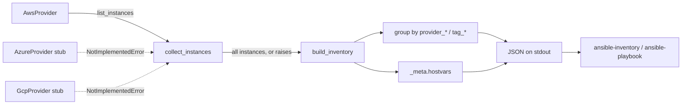

# Dynamic Ansible inventory

A Python script implementing Ansible's dynamic inventory contract (`--list` / `--host`) for AWS EC2, grouping hosts by tag and provider. Azure and GCP are retained interface-only stubs that raise `NotImplementedError`. Validation uses fakes in CI.

## Problem

Write a script that generates dynamic inventory for Ansible from
AWS/Azure/GCP APIs, grouping hosts by tag and provider, behind one
provider interface.

## Scope

- **AWS is the only real adapter.** `AwsProvider` calls a boto3 EC2
  client's `describe_instances`, paginates, filters to `running`
  instances, and normalizes them into `Instance` objects.
- **Azure and GCP are interface-only stubs.** `AzureProvider` and
  `GcpProvider` both raise `NotImplementedError`. They exist to show the
  adapter shape (`Provider.list_instances() -> list[Instance]`) that a
  real implementation would fill in, not as partial implementations.
- This is Terraform-free: the brief offered "Terraform `null_resource` +
  `local-exec`, or a pure Python script" — this repo takes the Python
  script path, since it can implement the inventory contract directly
  instead of shelling out from Terraform.

## How it works



If any provider's `list_instances()` raises, `collect_instances` lets
that exception propagate immediately. `inventory.py` catches it at the
top level, prints a message to stderr, and exits non-zero — it never
prints a partial inventory to stdout. A caller that only checks the exit
code, or that greps stdout for valid JSON, will see the failure either
way.

### Grouping scheme

- `provider_<name>` — one group per provider, e.g. `provider_aws`.
- `tag_<key>_<value>` — one group per tag key/value pair found on an
  instance, lowercased with non-alphanumeric characters replaced by `_`,
  e.g. an `env=prod` tag becomes `tag_env_prod`.
- `_meta.hostvars.<hostname>` — `ansible_host` (private IP, falling back
  to public IP, falling back to the hostname itself), `provider`,
  `instance_id`, and the raw `tags` dict.

## Usage

```bash
pip install -r requirements.txt

# list the full inventory (needs real AWS credentials/region to do anything useful)
./inventory.py --list

# legacy per-host lookup; always returns {} since --list already
# populates _meta.hostvars for every host, per the Ansible contract
./inventory.py --host web-01.example.com

# use it as an Ansible inventory source
ansible-inventory -i inventory.py --list
ansible-playbook -i inventory.py site.yml
```

## Known limitations

- Only `running` EC2 instances are included; stopped/terminated
  instances are skipped.
- Azure and GCP are not implemented — calling either adapter raises
  immediately.
- Single AWS region per invocation (`--region`, default `us-east-1`).
- No caching: every `--list` call re-queries the provider.

## Security

- No credentials are bundled or required for anything in this repo's
  tests. `AwsProvider` takes an already-constructed boto3 client, so
  callers control how credentials are supplied (environment, profile,
  instance role, etc.) and this script never touches credential
  material directly.
- For real use against AWS, the minimum IAM permission needed is
  `ec2:DescribeInstances` (read-only) — the adapter makes no mutating
  calls.
- Example IDs/hosts in fixtures use placeholder account `123456789012`
  and `*.example.com` hostnames.

## Idempotency

The script is read-only and stateless: it makes no changes to any
provider and holds no local state between runs. Re-running it against
unchanged infrastructure produces the same grouping and hostvars every
time (aside from ordinary infra drift between calls, which is not this
script's concern).

## Validation level

Tested:
- `AwsProvider` pagination, tag/IP capture, and running-state filtering,
  against a hand-written fake EC2 client (`tests/test_aws_provider.py`).
- The fail-loud contract: a fake client that raises is asserted to raise
  `ProviderError` (`tests/test_aws_provider.py`), and the CLI is asserted
  to exit non-zero with stderr output and empty stdout when AWS client
  construction fails (`tests/test_cli.py`).
- Grouping/hostvars aggregation logic in isolation, including IP
  fallback order (`tests/test_build.py`).
- `--host` legacy behavior (`tests/test_cli.py`).
- The `--list` JSON output's shape against the Ansible dynamic inventory
  contract, by running the real `ansible-inventory` CLI over a fixture
  script in CI (`tests/fixtures/fixture_inventory.py`).

Not tested:
- Never run against a real AWS, Azure, or GCP account. No network calls
  happen anywhere in this repo's tests or CI.
- Azure/GCP adapters beyond "they raise `NotImplementedError`."
- Behavior under AWS API throttling/retries (boto3's own retry config is
  relied on as-is, not exercised here).
- `ansible-inventory` could not be run locally during development on
  this Windows machine (`ansible-core`'s CLI requires POSIX blocking-IO
  semantics not available on Windows); it is exercised in CI on
  `ubuntu-latest` instead.
